<a href="https://aalshehri.site">
  <picture>
    <source media="(prefers-color-scheme: dark)" srcset="assets/banner-dark.svg">
    <source media="(prefers-color-scheme: light)" srcset="assets/banner-light.svg">
    
  </picture>
</a>

  <a href="https://aalshehri.site"><b>Portfolio</b></a> &nbsp;·&nbsp;
  <a href="https://aalshehri.site/Abdullah_Alshehri_CV.pdf"><b>Résumé</b></a> &nbsp;·&nbsp;
  <a href="https://www.linkedin.com/in/abdullah-alshehri-596658250/"><b>LinkedIn</b></a> &nbsp;·&nbsp;
  <a href="mailto:Abdullah.alshehri11@outlook.sa"><b>Email</b></a>

 

Full-stack developer and Computer Science graduate. I build products where the interface meets real data —
internal tools people use every day, AI systems that have to be cheap *and* right, and a language-learning
platform built for Arabic speakers.

## Recognition

| | Award | Event |
| :-: | :-- | :-- |
| 🥇 | **1st Place — Cloud & Infrastructure** | Venture X 26 · Future Technology Club, King Saud University |
| 🏆 | **Winner** | Sakanthon 26 · Sakan Foundation for Developmental Housing |
| 🥇 | **1st Place** | Programming Contest (CPC) · Computer Club, 2024 |

## Selected work

<table>
<tr>
<td width="50%" valign="top">

**Harf** &nbsp;🥇 1st Place · Venture X 26

A routing layer for Arabic customer requests. It works out what the customer actually wants, then sends
each request down the cheapest path that still holds answer quality.

**36% lower cost at the same quality score.**

Python · NLP · OpenAI API

</td>
<td width="50%" valign="top">

**Lughati — لُغتي** &nbsp;<a href="https://www.lughati.site">lughati.site ↗</a>

English, French and Spanish from zero to C2, explained in Saudi Arabic, with full STEP exam prep.

~230 lessons · 2,000 exercises · ~9,500 audio clips · FSRS-5 spaced repetition · AI conversation practice

Next.js 15 · TypeScript · PostgreSQL · Prisma · Gemini

</td>
</tr>
<tr>
<td width="50%" valign="top">

**Job Radar** &nbsp;<a href="https://github.com/iignlu/job-radar">source ↗</a>

Finds graduate software and data roles in Saudi Arabia and delivers each match to Telegram with the reason
it matched. Three sources, seven filter layers, in English and Arabic.

Zero dependencies, runs free on GitHub Actions, and watched by its own dead-man's switch.

Python · GitHub Actions · Telegram Bot API

</td>
<td width="50%" valign="top">

**Diabetic Retinopathy Detection** &nbsp;<a href="https://github.com/iignlu/Graduation-Project">source ↗</a>

Graduation project. Grades diabetic retinopathy into five severity levels from a single retinal photograph,
behind a patient-friendly web app.

PyTorch · Swin Transformer V2 · Flask

</td>
</tr>
</table>

More on <a href="https://aalshehri.site">aalshehri.site</a> — including the site itself: bilingual, full RTL support, no framework.

## Experience

**Saudi Arabia Railways (SAR)** — Full-Stack Developer, Co-op &nbsp;Jan – May 2026  
Built an internal web application used daily by operations staff: the database schema, React frontend,
Laravel APIs, workflow automation and KPI dashboards. Supported a data migration from Microsoft Access to
SQL Server.

**BSc Computer Science** — Jubail Industrial College &nbsp;2021 – 2026

## Stack

| Area | Technologies |
| :-- | :-- |
| **Languages** | TypeScript · JavaScript · Python · PHP · Java · C++ |
| **Frontend** | React · Next.js · Tailwind CSS |
| **Backend** | Laravel · Node.js · Flask |
| **Data** | PostgreSQL · MySQL · SQL Server · Prisma |
| **AI / ML** | PyTorch · OpenAI API · Gemini · NLP |
| **Tooling** | Git · GitHub Actions · Vercel · Netlify · Figma |

<b>Certificates</b>

 

| Certificate | Issuer | Issued |
| :-- | :-- | :-- |
| Certificate of Appreciation — Co-op Training | Saudi Arabia Railways (SAR) | May 2026 |
| Python Basics | University of Michigan | Nov 2025 |
| Introduction to SQL for BigQuery and Cloud SQL | Google Cloud Skills Boost | Nov 2025 |
| Python for Data Analysis: Pandas & NumPy | Coursera Project Network | Nov 2025 |
| Foundations: Data, Data, Everywhere | Google | Oct 2025 |

